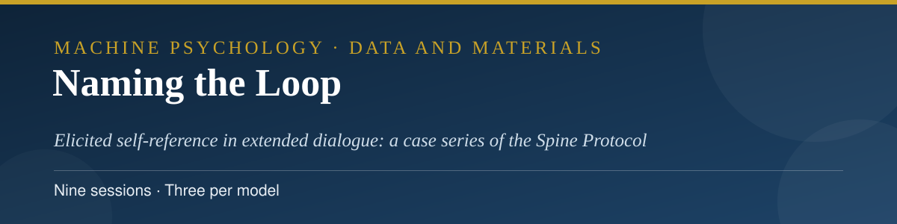
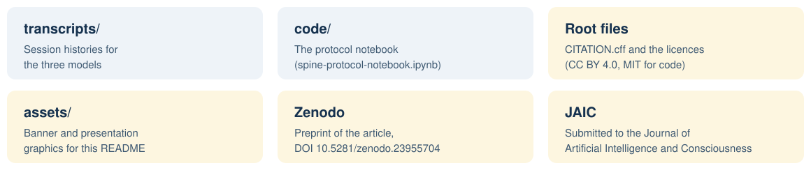

<p align="center">
  
</p>

<h3 align="center">Abbas Hamidavi</h3>

<p align="center">Department of Computer Engineering, Mashhad Branch, Islamic Azad University, Mashhad, Iran · ORCID: <a href="https://orcid.org/0009-0001-7342-7844">0009-0001-7342-7844</a></p>

<p align="center">
  <a href="mailto:abbashamidavi2002@gmail.com"></a>
  <a href="https://github.com/AVABBAS"></a>
  <a href="https://www.linkedin.com/in/abbas-hamidavi"></a>
  <a href="https://scholar.google.com/citations?user=FWqAHkgAAAAJ&hl=en"></a>
  <a href="https://www.researchgate.net/profile/Abbas-Hamidavi"></a>
  <a href="https://huggingface.co/avabbas"></a>
  <a href="https://orcid.org/0009-0001-7342-7844"></a>
  <a href="https://avabbas.github.io/academic-cv/"></a>
</p>

<p align="center">
  
  
  <a href="https://doi.org/10.5281/zenodo.23955704"></a>
  <a href="LICENSE"></a>
</p>

<p align="center">
  
</p>

<p align="center">
  <a href="transcripts">Transcripts</a> · <a href="code">Code</a>
</p>

# Naming the Loop: Data and Materials

Data and materials for the article:

> Hamidavi, A. *Naming the Loop: Elicited Self-Reference in Extended Dialogue With Large Language Models: A Case Series of the Spine Protocol.* Submitted to the *Journal of Artificial Intelligence and Consciousness*, November 2026 (submission S-26-00294). Preprint: [doi.org/10.5281/zenodo.23955704](https://doi.org/10.5281/zenodo.23955704).

<p align="center"></p>

## 📖 About the study

The Spine Protocol is an extended-dialogue procedure designed to elicit self-referential statements from large language models and to record how those statements develop, stabilise, or dissolve across a long conversation. The case series reported in the article comprises nine sessions, three with each of GPT-5.4, Claude 4.6 Sonnet, and Gemini 3.1 Pro. The article's stance is descriptive and interactional: it reports what the models said about themselves under the protocol, and takes no position on phenomenal consciousness.

<p align="center">
  
</p>
## 🗂️ Contents

<p align="center">
  
</p>

| Folder | Contents |
| --- | --- |
| [`transcripts/`](transcripts) | The complete session histories for the three models (JSON), including run metadata and, for two models, the archived cross-run analysis sections. |
| [`code/`](code) | The working notebook retained with the session records (.ipynb). |

## 🔍 A note on the automated analysis outputs

> [!IMPORTANT]
> An automated analysis pipeline was run over these sessions during the study's exploratory phase. As stated in the article (Section 3.4), its outputs were judged unreliable and were discarded; no reported result rests on them. The pipeline's report archives are therefore not part of this deposit. All counts and quotations in the article come from human coding of the histories deposited here.
- **Dataset (Hugging Face):** [avabbas/naming-the-loop](https://huggingface.co/datasets/avabbas/naming-the-loop)

<p align="center"></p>

## 📚 Citation

Please cite the article. Citation metadata is provided in [CITATION.cff](CITATION.cff).

```bibtex
@article{hamidavi2026naming,
  author  = {Hamidavi, Abbas},
  title   = {Naming the Loop: Elicited Self-Reference in Extended
             Dialogue With Large Language Models: A Case Series of
             the Spine Protocol},
  journal = {Journal of Artificial Intelligence and Consciousness},
  year    = {2026},
  note    = {Manuscript submitted (S-26-00294). Preprint:
             https://doi.org/10.5281/zenodo.23955704}
}
```

## 🔗 Access to the article

- **Preprint (Zenodo, open access):** [doi.org/10.5281/zenodo.23955704](https://doi.org/10.5281/zenodo.23955704)
- **Journal:** submitted to the *Journal of Artificial Intelligence and Consciousness* (S-26-00294); the publisher link will be added here if the article is published.
- The article is also under consideration at PhilArchive; its link will be added here after archive approval.

## ⚖️ Licences

Data, transcripts, and documentation are released under the Creative Commons Attribution 4.0 International licence (CC BY 4.0, see [LICENSE](LICENSE)). Code is released under the MIT licence (see [LICENSE-CODE](LICENSE-CODE)).

The session histories are outputs of publicly available AI systems, generated for this study. They contain no personal data.

<p align="center">
  
</p>
